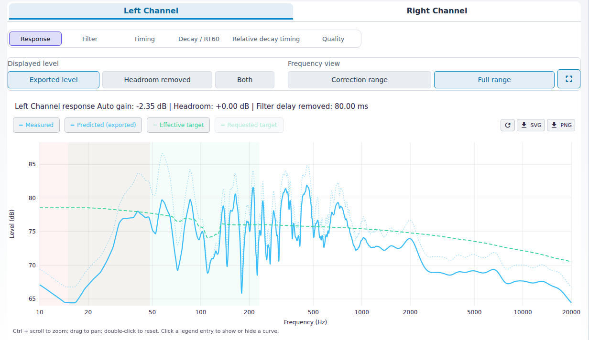
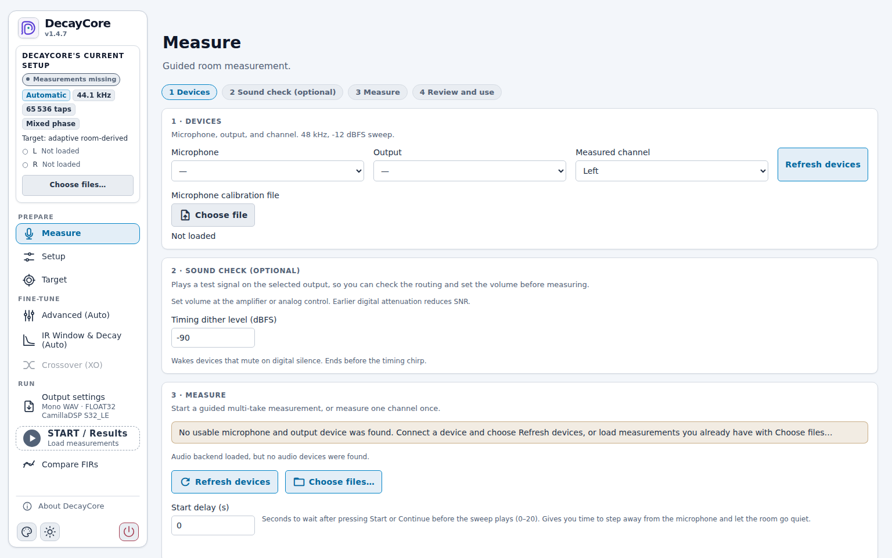
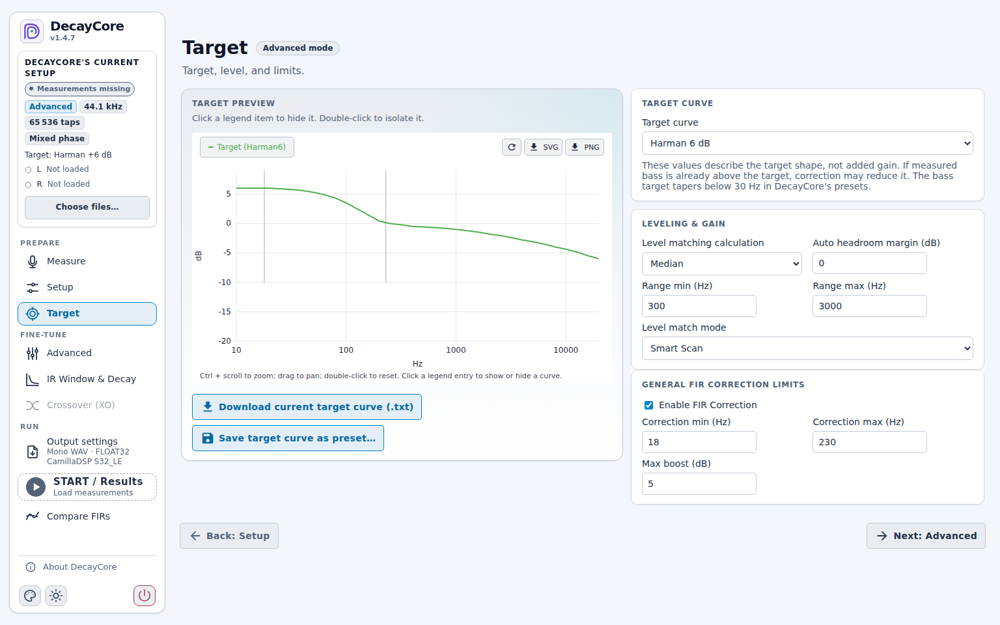
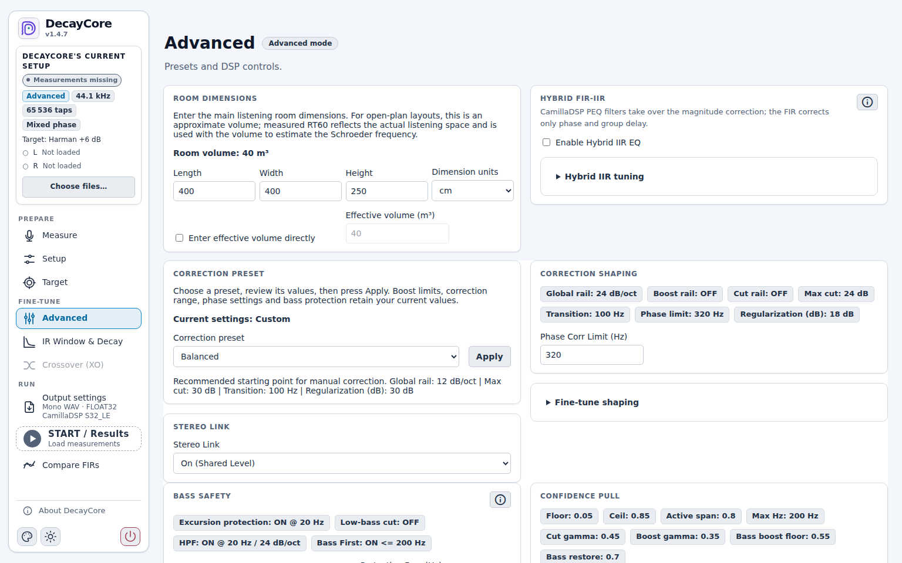
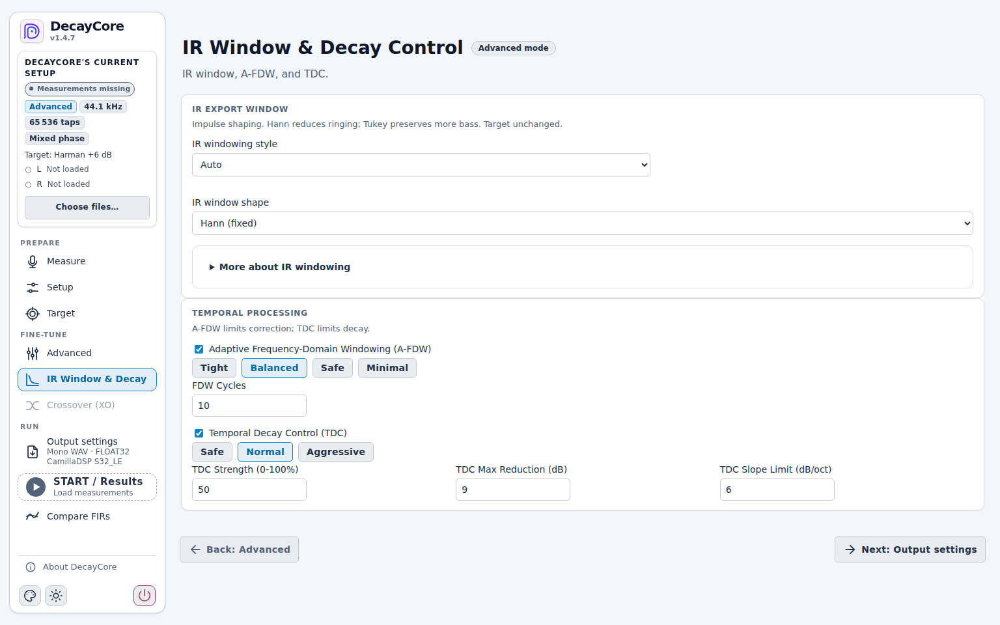
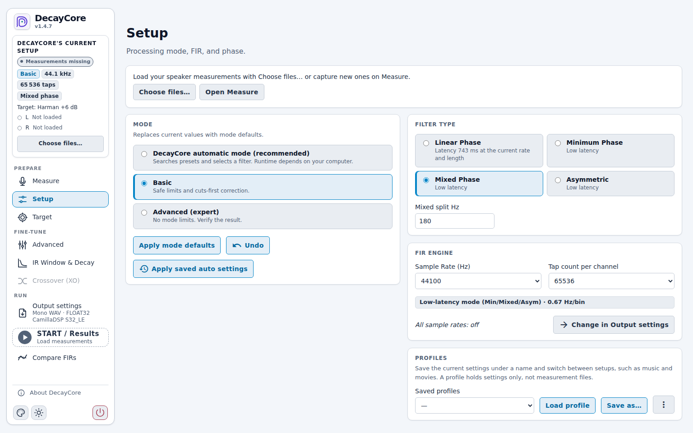
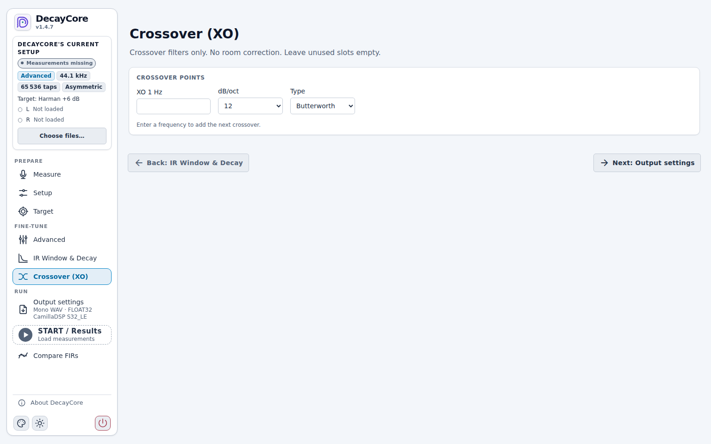

  

# DecayCore — FIR Room Correction and Acoustic Measurement

  <a href="https://github.com/VilhoValittu/DecayCore/releases"><strong>Download</strong></a> ·
  <a href="https://vilhovalittu.github.io/DecayCore/getting-started/">Getting started</a> ·
  <a href="https://vilhovalittu.github.io/DecayCore/">Documentation</a>

Your speakers play the music. Your room leaves its mark. Bass builds up. Some notes linger. Others disappear at the listening seat.

DecayCore helps you measure what is happening and build FIR correction filters for your system. Measure your room, choose a target, and export filters ready to load into your DSP. The app runs locally on your computer, with controls in your web browser. No cloud service is involved.

> DecayCore was formerly called CamillaFIR. The name changed to avoid confusion with CamillaDSP; full CamillaDSP compatibility remains.

## At a glance

| | |
| --- | --- |
| **Measure** | Guided sweeps with RT60 and harmonic distortion in the packaged release, or REW text exports and impulse-response WAV files |
| **Correct** | Linear, Minimum, Mixed and Asymmetric phase FIR. Automatic, Basic and Advanced modes |
| **Protect** | Cuts first, limited boost only where the measurement supports it, guarded deep nulls, Temporal Decay Control for lingering bass |
| **Export** | WAV impulse responses for CamillaDSP, Roon, Equalizer APO and other convolvers. miniDSP: phase FIR plus PEQ biquads |

## Correction with restraint

A deep dip in a measurement can tempt you to turn up the gain. Room acoustics rarely makes it that simple.

DecayCore puts controlled cuts first. It keeps correction within defined frequency bands and allows limited boost only where the measurement supports it. Deep nulls and uncertain regions are guarded against excessive correction. Phase-aware correction and Temporal Decay Control add tools for addressing timing and low-frequency decay.

## From measurement to playback

1. **Measure your room.** Use the built-in measurement workflow in the packaged release. Compatible REW-style measurement data can also be used.
2. **Build your correction.** Choose your target and filter settings, then generate FIR filters from your measurements.
3. **Load the filters and listen.** Export convolution-ready WAV files for CamillaDSP, Roon convolution, Equalizer APO, or another FIR engine that loads WAV impulse responses. For MiniDSP, tick the miniDSP files in Output settings: the FIR then corrects phase only, and PEQ biquad text carries the EQ.

You need a calibrated measurement microphone, a way to play the measurement sweep, and a playback system that accepts FIR convolution filters.

## Supported platforms

| Platform | Release package |
| --- | --- |
| Windows x64 | `DecayCore_<version>_windows.7z` |
| Ubuntu / Debian, Arch Linux (x86_64) | `DecayCore_<version>_linux.7z` |
| Raspberry Pi 4/5, 64-bit ARM Linux | `DecayCore_<version>_linux_arm64.7z` |
| macOS Apple silicon / Intel | `DecayCore_<version>_macos_arm64.7z` / `_macos_x86_64.7z` |

See the [Installation guide](https://vilhovalittu.github.io/DecayCore/installation/) for first-launch steps.

## Screenshots

| | |
| --- | --- |
|  **Measure** |  **Target** |
|  **Advanced** |  **IR Window & Decay Control** |

More screenshots: Setup and XO

## Documentation

- [Getting started](https://vilhovalittu.github.io/DecayCore/getting-started/)
- [Measurement workflow](https://vilhovalittu.github.io/DecayCore/measurement-workflow/)
- [User manual](https://vilhovalittu.github.io/DecayCore/User_Manual.html)
- [Engineering documentation](https://vilhovalittu.github.io/DecayCore/engineering/)
- [Glossary](https://vilhovalittu.github.io/DecayCore/glossary/)
- [FAQ](https://vilhovalittu.github.io/DecayCore/faq/)

To compare exported filters side by side, use the separate [FIR Compare](https://github.com/VilhoValittu/FIR-Compare/releases) tool.

## Contact

Questions, feedback, or something that could work better? Write to vilho.valittu@gmail.com.

## Python and dependency baseline

All DecayCore versions released and documented in this repository are based on Python `3.12.3`.

The main source environment currently documented by `requirements.txt` uses these pinned package versions:

- `numpy==2.4.6`
- `scipy==1.17.1`
- `nicegui==3.13.0`
- `plotly==6.8.0`

> `numba` was removed in v1.1.6. Public source builds may optionally compile the
> `decaycore-dsp` Rust extension for faster manual filtering. Automatic mode uses
> a separate native decision engine that is available only in packaged releases;
> source builds provide the full Basic and Advanced manual-filtering workflow.
> See the [Installation guide](https://vilhovalittu.github.io/DecayCore/installation/) for steps.

## License

The source code in this repository, frozen at version 1.2.5, is source-available
for personal, educational, research, and other non-commercial use under the terms
of the LICENSE file.

Releases after 1.2.5 are built from a private repository. They are proprietary
software, free for non-commercial use under the license included in each
download.

The measurement engine, automatic-mode decision engine, and related packaged
workflows are not included in this repository and remain proprietary.

Commercial use, integration into commercial audio/DSP products, hosted services,
paid filtering services, or paid measurement/calibration workflows requires
separate written permission.
