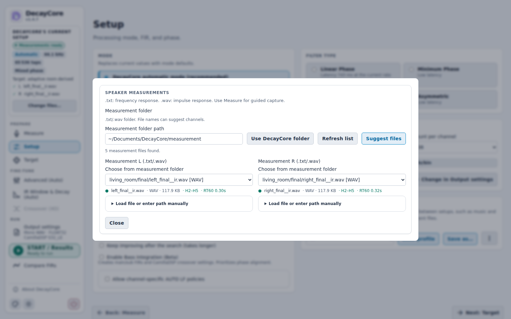

This manual follows the work you do in DecayCore: prepare measurements, choose a workflow, generate filters, inspect the result, and deploy it safely.

## 1. Before you start

You need:

- a calibrated measurement microphone
- separate Left and Right measurements
- a playback system that accepts FIR convolution filters
- a way to start playback at a low volume

DecayCore accepts impulse-response WAV files and text exports containing frequency, magnitude, and phase. Packaged releases also include guided measurement and **DecayCore automatic mode (recommended)**.

> **Source-build note:** the public source checkout provides the complete **Basic** and **Advanced** manual workflows. Guided measurement and the native Automatic mode decision engine are included only in packaged releases.

### A safe first run

1. Use **Measure** for guided Left and Right measurements with RT60 and harmonic data, then press **Use final measurements**. To import existing measurements, open **Choose files…** in the sidebar.
2. Select **DecayCore automatic mode (recommended)** and **Asymmetric**.
3. Keep the **balanced** goal and **Adaptive: derive target from room acoustics** target strategy.
4. Press **START** on **START / Results**.
5. Check the warnings and selected solution.
6. Export the ZIP, load the filters, and listen to familiar music.

When running from source, use **Basic** instead of Automatic mode.

## 2. Measure or import

### Select measurement files

Open **Choose files…** in the sidebar's current setup summary. The window shows
the measurement folder and the Left and Right channels side by side. Select
each channel's file from the folder, or expand **Load file or enter path manually**
to upload a file or enter its path. **Suggest files** uses file names to suggest
channel assignments; check the assignments before running correction.

The sidebar shows the selected file for each channel. Once all required channels
are loaded, the button changes to **Change files…**. With bass integration enabled,
the same window shows the main and subwoofer channels.

### Guided measurement

This is the recommended source for correction when your platform and routing support it. DecayCore analyses the recorded sweep for RT60 decay and harmonic distortion as well as the speaker response. RT60 provides measured decay information; the harmonic curves support boost-risk guidance. Keep the saved session files together so these results remain available when reloading the WAVs.

Open **Measure** and configure the input device, output device, microphone calibration, selected channels, positions, and repeats. The guided session measures each selected channel, pauses when the microphone must move, rejects unusable takes, and saves one impulse-response WAV per channel.

Set measurement volume at the end of the signal chain, such as the amplifier or an analog volume control. Digital attenuation earlier in the chain also lowers measurement signal-to-noise ratio.

Keep all WAV files from one session at their original gain and timing. Do not normalize channels separately or move each impulse to a different time origin.

On Windows, subwoofer measurement requires the playback device to be configured for 5.1 or 7.1. The sweep uses the LFE channel. Main-speaker measurement has also been verified on Ubuntu 22.04; macOS measurement has not been verified on project hardware.

### REW text files

Export Left and Right separately with:

- frequency in hertz
- magnitude in decibels
- phase in degrees

Normal REW headers and comments are accepted. Phase is required for phase-aware correction.

### Impulse-response WAV files

Use mono WAV files with consistent sample rate, gain, and timing. When exporting from REW, use the same options for every channel; `float32`, normalization, and consistent `t=0` placement are suitable defaults.

A suitable imported IR can provide RT60 from its recorded decay. Standard frequency-response text exports lack that decay information, and ordinary linear IR WAVs do not include the separate harmonic curves saved by DecayCore. Imports remain supported, but use DecayCore's own measurement when possible to supply the fuller set of measurement data.

### Input checklist

- Avoid clipping, background noise, and changed routing between channels.
- Use the same microphone position and procedure for corresponding measurements.
- Keep sample rates consistent when practical.
- Check that Left and Right files are not swapped.

## 3. Choose the operating mode

Select the operating mode on **Setup**. Opening **Advanced** or **IR Window & Decay Control** keeps the selected mode.

All modes use the same DSP engine. The mode changes who chooses the settings and how tightly the interface constrains them.

### Automatic mode

Automatic mode evaluates candidate presets, ranks them against the current measurements, refines the winner, and applies it before export. It is the recommended starting point in packaged releases.

Choose an AUTO goal:

- **balanced** — general-purpose default
- **room-safe** — more conservative for difficult measurements
- **low-ripple** — prioritizes smoother low-frequency response around modes
- **prefer bass** — gives bass target matching more weight
- **subwoofers** — focuses analysis and leveling on subwoofer work

The scores compare candidates from the same measurement set. Do not use them to compare unrelated speakers or rooms.

To see how the goals differ on one real measurement, open the [Automatic goal comparison](https://vilhovalittu.github.io/DecayCore/auto-mode-goals-demo/).

Automatic mode manages many Advanced settings. These settings are collapsed under **Show detailed settings** on Advanced and IR Window & Decay Control. Room dimensions remain visible. Fields that remain enabled are deliberate expert overrides. The final summary reports the effective values used, including any winner refinement.

### Basic

Basic provides manual control with conservative defaults and hard safety clamps. Use it for source builds, learning the controls, or making a repeatable manual reference filter.

### Advanced

Advanced exposes more correction, phase, timing, and protection controls. It is intended for measured experiments where you understand the effect of each change. Safety-critical numerical guards remain active.

In the Correction preset section on Advanced, choose **Strict**, **Balanced** or **Loose**, review the
preview, then press **Apply**. Strict uses tighter correction limits; Balanced is
the recommended starting point; Loose allows more freedom for fine-tuning. Each
preset sets the correction slope limit, maximum cut, transition width and
regularization. Your boost limits, correction range, phase settings and bass
protection retain their current values. Changing a preset value manually shows
**Custom**. Automatic mode locks the preset controls because it manages these
settings itself.

Selecting a mode does not rewrite every visible value. Use **Apply mode defaults** when you want to reset the controls to that mode's baseline.

## 4. Choose the target and filter type

### Target strategies in Automatic mode

- **Adaptive: derive target from room acoustics** (default) scores built-in curves to select a base, then makes low-frequency changes of at most ±1 dB from stereo measurement evidence. Reliable RT60 data can permit additional bass lift, but never creates it by itself.
- **Auto: search best built-in** evaluates several built-in curves and selects the best-ranked result. A good alternative when measurement metadata is limited or the sources are external.
- **Use selected target curve from Target page** uses the curve you chose or imported and skips automatic target selection.

In Basic and Advanced modes, select the target directly on **Target**. A mild house curve is usually a safer starting point than a perfectly flat in-room target.

### Filter types

| Filter type | Use it when | Main tradeoff |
|---|---|---|
| **Asymmetric** | You want the recommended general-purpose result. | Balances latency, phase correction, and pre-ringing containment. |
| **Minimum Phase** | Low latency and causal behavior matter most. | Does not provide linear-phase correction. |
| **Mixed Phase** | You want bounded excess-phase correction in a selected band. | Needs careful phase limits and verification. |
| **Linear Phase** | Linear-phase behavior matters more than latency. | Long filters can add latency and energy before the main impulse. |

## 5. Set practical limits

For a first run, leave mode defaults in place. These controls matter most when diagnosing or comparing results.

### Sample rate and taps

Match the sample rate to the playback pipeline. More taps give better low-frequency and time resolution but increase processing cost and latency. Multi-rate export scales the tap count for each sample-rate family.

### Automate tap count

In packaged builds, tick **Automatic tap count** under **Run** on
**START / Results** and press **START**. It works with **Standard** and with
**All four filter types**, where each type gets its own tap count. This generates filters with
the current settings and then shortens their exported support within a strict
response-error bound: at every frequency the exported filter stays within 1%
(about 0.09 dB) of the design response, measured against the local response with
a floor of 0.1% of the response peak. It works with Asymmetric, Minimum, Mixed
and Linear Phase.
The taps setting still controls the design resolution; it is not replaced by
the final export length. Each sample rate is checked separately.

All output channels share the same crop and removed delay, preserving their
relative timing. Odd final lengths receive one trailing zero. If no shorter
support passes, the existing support is retained, with even-length padding when
needed. The results show design/output taps and the actual common delay removed.
Response and scoring diagnostics describe the design before this final step;
impulse metrics describe the exported filters. Shorter support does not always
mean lower delay, particularly with minimum-phase filters.

When the usual tap-count check cannot find a shorter filter, an enabled
high-pass filter permits a small additional absolute response error below its
cutoff (0.002% of each channel's response peak). Limits at and above the cutoff
remain unchanged. Results and the export summary identify when this allowance
was used. Runs without a high-pass filter, and runs with a separate sub output,
retain the original error limits.

### Correction range

Use the lower and upper correction limits to keep correction inside the measured, trustworthy band. Broad full-range correction requires better measurement quality than bass-focused correction.

### Maximum boost and cut

Maximum boost is a ceiling, not a target. Deep cancellation dips often change with microphone position and should not be filled aggressively. Cuts are usually more reliable for reducing peaks.

Maximum cut controls the strongest permitted attenuation. Leave enough headroom for the target and any boost that remains.

### Local correction threshold

**Ignore local correction below (dB)** removes narrow correction details smaller than the threshold while keeping the broad response shape. The range is `0–3 dB`; `0` keeps all local detail and larger values produce a smoother filter.

### HPF and low-bass protection

A high-pass filter (HPF) protects the system below its useful range. In Automatic mode, enabling HPF lets the search choose its frequency and slope. Low-bass boost lock and Excursion Protection can block risky boost while still allowing cuts.

Asymmetric, Mixed Phase and Minimum Phase filters keep the HPF's natural minimum-phase response, so it adds no pre-ringing. Linear Phase makes it linear-phase, which rings equally before and after the peak. Below 65,536 taps the HPF runs as a separate IIR filter and the FIR leaves it alone. **HPF in the final FIR** in the Results tab compares the exported filter with the HPF you set. Very steep settings reach a floor near -60 dB because the filter is finite.

### Level matching and Stereo Link

Level matching establishes the reference between measurement and target. Stereo Link keeps left and right decisions coherent without forcing identical correction where the channels differ.

## 6. Advanced correction features

### Temporal Decay Control

Temporal Decay Control (TDC) reduces supported low-frequency energy that decays too slowly. It is separate from ordinary magnitude matching. Use it only where measurement evidence indicates a decay problem, and keep strength and maximum reduction bounded.

### Adaptive Frequency-Domain Windowing

Adaptive Frequency-Domain Windowing (A-FDW) changes analysis resolution with frequency and acoustic confidence. It helps the filter follow broad, repeatable behavior instead of narrow reflection detail.

### Phase correction

Excess-phase strength controls how much supported phase error is corrected. **Full phase correction up to** and **Phase correction faded out by** bound the correction band. The group-delay gradient limit contains abrupt timing changes.

### Hybrid IIR + FIR

Hybrid IIR can move supported narrow bass cuts into CamillaDSP peaking filters and let FIR handle the remaining broadband magnitude and phase correction. The exported CamillaDSP configuration must include both IIR and FIR stages; loading only the WAV omits the transferred cuts. Hybrid IIR can't be ticked while Output settings adds Equalizer APO, PipeWire, HLC, Roon or JRiver files, because those play the FIR alone. The miniDSP files carry the cuts in their PEQ filters. Ticking one of them unticks Hybrid IIR. While Hybrid IIR is on, the setup panel shows a **Hybrid IIR** chip.

### Bass Integration

Bass Integration uses separate main and subwoofer impulse measurements to create a phase-aligned shared sub branch. With two subwoofers, DecayCore combines their measured responses and exports one shared mono Sub FIR. Apply the reported crossover, delay, polarity, and gain settings, then verify them in the room.

### IR export windowing

Impulse-response export windowing controls how the final FIR is placed and shaped in time. It does not change the target or the correction policy used to design the filter. **auto** is the normal choice; **rew_asym** provides a REW-style asymmetric window.

### XO Phase Model

The crossover phase model describes expected crossover rotation so phase correction does not mistake it for an unrelated loudspeaker error. Use it only when the crossover topology and slopes are known.

Each of the five XO slots takes a corner frequency, a slope and a type. **Butterworth** is the default. **Linkwitz-Riley** applies to 12, 24, 36 and 48 dB/oct; 6 and 18 dB/oct are always Butterworth. The type sets the modelled phase turn around the corner, not the frequency response. At 80 Hz the two differ by 1 to 3.5 ms of group delay, depending on the slope. At 2 kHz the difference is under 0.15 ms.

The filter inverts the phase of every crossover you enter, so an entry the speaker does not have adds phase error instead of removing it. After a run, **XO model fit** in the Results tab compares each crossover with the measured phase:

- **good** or **partial**: the measurement contains the crossover; the percentage is the share of the leftover group-delay spread it removes.
- **weak**: the crossover explains little of the measurement.
- **mismatch - check XO**: the measurement shows less group-delay spread without this crossover than with it. Recheck the frequency, slope and type. The log carries the same warning.
- **not verifiable**: the crossover's own group-delay swing is under 1 ms, room reflections hide it, or it lies outside the measured range. At 24 dB/oct the first case starts at about 250 Hz.

The check only reports; it never changes the filter. With a low crossover, an Asymmetric filter also limits room phase correction so the filter adds no pre-ringing beyond the crossover's own.

## 7. Generate and read the result

Open **START / Results** and press **START**. For separate results for all four filter types, choose **All four filter types** under **Run** first. This runs the full calculation for each type and takes longer than a single run. The choice isn't saved, so DecayCore starts with **Standard** next time. During an Automatic run, DecayCore may evaluate targets, search preset candidates, refine finalists, and validate the winner. Repeated runs with the same measurements and relevant settings may reuse compatible cache data.

Review these items before export:

- **System Health:** resolve every `CRIT`; inspect each `WARN`.
- **Magnitude:** confirm the broad target match improved without implausible boost.
- **Phase and Group Delay:** look for contained, smooth timing behavior.
- **Filter:** check the actual correction demand and headroom.
- **Impulse:** inspect energy around the main peak, especially with linear or mixed-phase filters.
- **Summary:** confirm mode, target, effective limits, warnings, and Automatic winner details.

Automatic ranking compares filters made from the same measurements. It is not a sound-quality score.

### Compare filters

**Compare filters** on the results page opens **Compare FIRs** with the run selected; after a run of **All four filter types**, every result of the batch is selected. The page lists saved runs from the filters folder, newest first, and accepts other FIR WAV files. Choose a channel and press **Create comparison**. The built-in FIR Compare saves an HTML report in `Documents/DecayCore/Analyze` and opens it in your browser.

With **Include predicted response and target tracking**, each filter is applied to the current WAV measurement and compared with the target saved with the newest selected run. FIR Compare analyzes the full impulse response without DecayCore's IR window, so its numbers can differ from the results page. Its differences are descriptive, not a ranking.

## 8. Export and deploy

The result ZIP normally includes:

- Left and Right FIR WAV files in the selected output format
- bypass FIR files for level- and timing-matched comparison
- `Summary_...txt`
- `Target_L_...txt` and `Target_R_...txt`: the target each channel was designed for, as REW-compatible text. An all-rates ZIP holds them once, at the selected sample rate
- CamillaDSP configuration files
- Sub FIR and crossover settings when Bass Integration is used
- `Config_...cfg` and `bypass/Bypass_Config_...cfg` for the HLC convolver, when you tick **HLC convolver file** in Output settings
- `MiniDSP/` with one `.bin` FIR file per output, the PEQ filters as `_PEQ.txt` biquad files and a short loading note, when you tick **miniDSP files (FIR .bin, PEQ .txt)** in Output settings

When you tick the Roon ZIP or the JRiver folder and no Equalizer APO, PipeWire or HLC file, the export leaves out the main FIR WAV files and the CamillaDSP files that load them. The Roon ZIP or the JRiver folder then holds the only copy of the filters.

The default output location is `Documents/DecayCore/filters/<version>/`. If it is not writable, the results page reports the fallback location.

### CamillaDSP

Use the generated YAML when possible, or add each WAV to the correct convolution channel. Hybrid IIR requires the exported peaking filters as well as the FIR stage. Confirm sample rate, channel routing, and gain.

### Roon

Tick **Roon convolution ZIP** in Output settings before the run. Load the `Roon_Convolution_...zip` from inside the export into **DSP Engine → Convolution**. Don't load the export ZIP itself: it also holds the bypass filters, and Roon may pick those. Roon picks the filter for the playback rate. The Roon ZIP is left out when the filters include subwoofer outputs.

### JRiver Media Center

Tick **JRiver convolution folder** in Output settings. Copy the `JRiver` folder from the export and choose a `.cfg` in **Tools → Options → Audio → DSP Studio & Output Format → Convolution**. The files are named, for example, `DecayCore2.0_441.cfg`, so JRiver switches to the matching file when the playback rate changes. JRiver keeps a loaded filter until it restarts, so restart it after you replace the files.

### HQPlayer

HQPlayer takes one filter per channel and scales it to the playback rate. Export with the Mono layout at the highest rate you play, then load the left and right WAV files in HQPlayer's convolution settings.

### Equalizer APO

Tick **Equalizer APO file** in Output settings for a ready-made config. Load each WAV through Convolution, verify channel assignment, and add enough preamp reduction to prevent clipping.

### miniDSP

miniDSP plugins don't load WAV files and run short FIR blocks next to a PEQ bank. Tick **miniDSP files (FIR .bin, PEQ .txt)** in Output settings before the run. The run then changes how the filter is built:

- The main-channel FIR corrects phase and group delay only, so all of its taps go to timing.
- The magnitude correction moves to peaking filters, cuts and boosts, fitted to the same safe correction curve the FIR would have used. Every boost limit still applies. Hybrid IIR cuts, when on, count toward the same filter budget.
- **miniDSP PEQ filters / output** in Advanced → Hybrid IIR tuning sets the budget, 10 by default to match the 2x4 HD.
- Below 65,536 taps the PEQ is fitted on a 65,536-tap design grid, so a short FIR doesn't limit the EQ resolution.
- The FIR carries the attenuation the largest boost needs, so the FIR and PEQ together don't clip.
- Equalizer APO, PipeWire, HLC, Roon and JRiver files are unavailable, because they would play the FIR without any EQ. The CamillaDSP file carries the same PEQ.
- Subwoofer outputs keep their EQ in the FIR.

Set the sample rate to the fixed rate your plugin runs at, for example 96 kHz on the 2x4 HD, and choose no more taps than its FIR block allows for each output. Load each `.bin` from the `MiniDSP` folder into the FIR block of the matching output, and each `_PEQ.txt` into the PEQ bank of the same output with the plugin's advanced biquad import. Without the PEQ files the correction has no EQ at all. With subwoofers, set the crossover, delay, gain and polarity in the plugin's own blocks, using the values in the CamillaDSP file. Choose Mixed Phase, Asymmetric or Linear Phase: Minimum Phase has no phase correction left for the FIR to do.

## 9. Listen

1. Start playback at reduced level.
2. Confirm Left, Right, and any Sub output are routed correctly.
3. Use recordings you know well.
4. Compare with bypass at the same volume.
5. Listen for missing bass, excess brightness, unstable imaging, or anything that sounds unnatural.

If it sounds worse, do not keep the filter because the graph looks better. Change one major setting at a time and listen again.

DecayCore does not apply exported filters to its own measurement sweep. A corrected-system measurement requires you to route the sweep through the convolver. It can help find setup errors, but it is optional and does not replace listening.

## 10. Troubleshooting

### The run will not start

Check that Left and Right files exist, are readable, and match the selected workflow. Resolve `CRIT` health checks. If the app still behaves unexpectedly, use **About DecayCore → Maintenance** to clear Automatic-mode caches or reset settings.

### The result sounds thin or bass is weak

Check target selection, HPF, Low-bass boost lock, Excursion Protection, TDC strength, channel routing, and subwoofer polarity. Make sure the convolver has not loaded a bypass or wrong-rate filter.

### The result sounds bright or aggressive

Lower the upper correction limit, choose a gentler target, increase smoothing, or compare with Basic mode defaults. Do not compensate by adding broad gain without checking headroom.

### Bass still rings

Confirm that the measurement is reliable and TDC is active where needed. A persistent room mode may need speaker or listening-position changes, acoustic treatment, or a carefully verified Hybrid IIR cut.

### Stereo image is unstable

Confirm consistent Left and Right measurements, correct file assignment, Stereo Link settings, and alignment. Re-measure if either channel was captured from a different microphone position or routing state.

### Many measurement takes are rejected

Check clipping, noise, cables, device selection, sweep level, and microphone movement. Fix the measurement before weakening quality checks.

## 11. Essential terms

- **FIR:** a finite impulse response filter used by a convolution engine.
- **IR:** an impulse response containing timing, phase, and magnitude information.
- **Target curve:** the response shape the correction aims toward.
- **Headroom:** unused digital level reserved to prevent clipping.
- **Excess phase:** phase behavior left after ordinary propagation delay and the chosen baseline are removed.
- **Group delay:** frequency-dependent delay, used to inspect timing behavior.
- **RT60:** an estimate of how long sound energy takes to decay by 60 dB.
- **Taps:** the number of samples in the FIR; more taps increase time span and processing cost.

A filter is successful only if it sounds better. A flatter graph on its own proves nothing.
